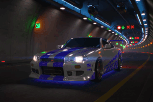

<h1 align="center">Hi 👋, I'm Shriram</h1>
<h3 align="center">Full-Stack Developer exploring LLMs, RAG, and AI agents to build intelligent applications.</h3>

  

- 🔭 I’m currently working on [AskDoc.ai](https://github.com/shriramphatale/askdoc-ai)

- 👨‍💻 All of my projects are available at [My Portfolio](https://shriramphatale.vercel.app/)

### Languages and Tools:

  
  
  
  
  
  
  
  
  
  

<!-- <h3 align="left">Support:</h3>

   -->

